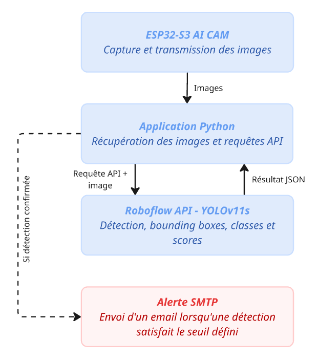
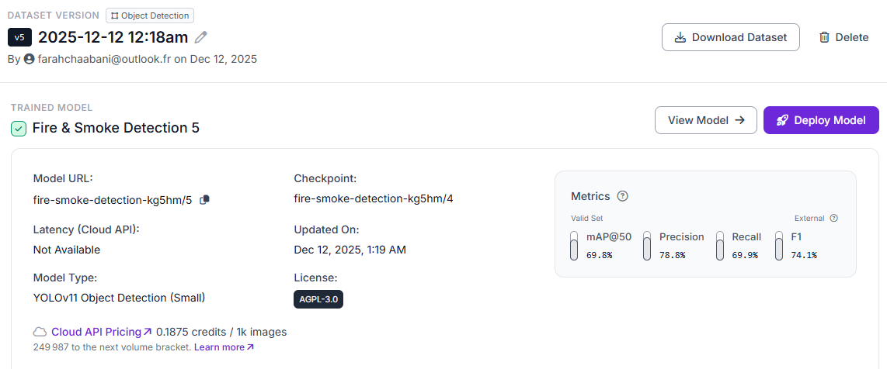
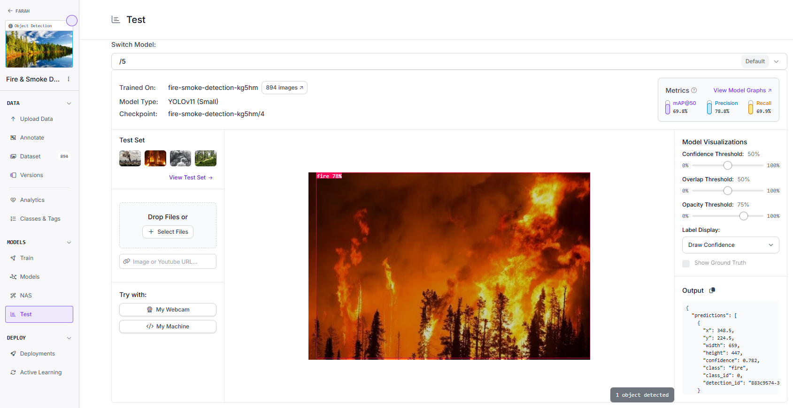
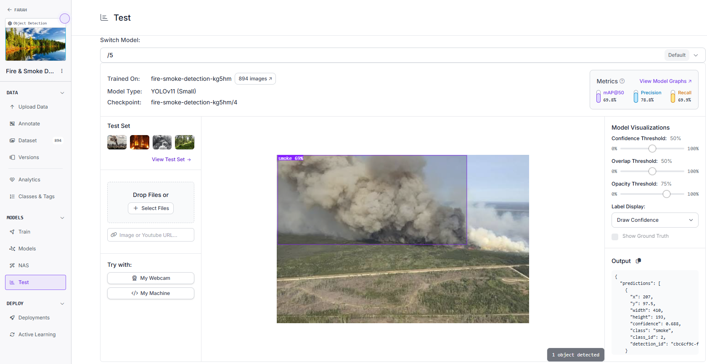
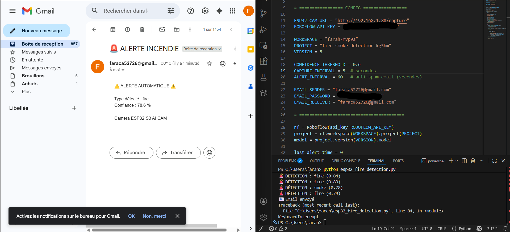

# 🔥 Fire & Smoke Detection Using YOLOv11s

AI-powered fire and smoke detection.

## 1. Project Overview

This project detects fire and smoke using YOLOv11s and automatically sends email alerts when the detection confidence exceeds a configured threshold.

## 2. Technologies

- Python
- YOLOv11 Small (YOLO11s)
- Roboflow API
- ESP32-S3 AI CAM
- Gmail SMTP

## 3. System Architecture

ESP32-S3 AI CAM → Python → Roboflow API → Detection Results → Email Alert



**Note:** AI inference runs on Roboflow, not on the ESP32.

## 4. Model Performance

| Metric | Result |
|---|---|
| mAP@50 | 69.8% |
| Precision | 78.8% |
| Recall | 69.9% |
| F1-score | 74.1% |

*Evaluated on the validation set.*



### Trained Model

**Model:** YOLOv11s  
**Version:** 5

[View Trained Model on Roboflow](https://app.roboflow.com/farah-mvp9a/fire-smoke-detection-kg5hm/models)

## 5. Detection Results

### Fire Detection


### Smoke Detection


These examples use external images not included in the training dataset.

## 6. Email Alert

An email is automatically sent through Gmail SMTP when fire or smoke is detected above the configured threshold.




## 7. Installation

Install the required Python dependencies:

```bash
pip install -r requirements.txt
```

The `requirements.txt` file contains:

```text
roboflow
requests
```

## 8. Configuration

Open **`inference.py`** and configure the following parameters.

**ESP32-S3 AI CAM**

```python
ESP32_CAM_URL = "http://192.168.1.25/capture"
```

Replace the IP address with your ESP32 camera's current IP address.

**Roboflow Model**

```python
ROBOFLOW_API_KEY = "TA_CLE_API_PRIVEE_ICI"
WORKSPACE = "farahchaaabani"
PROJECT = "fire-smoke-detection-kg5hm"
VERSION = 5
```

Replace the API key with your own Roboflow API key. Verify the workspace and model identifiers.

**Email Configuration**

```python
EMAIL_SENDER = "tonemail@gmail.com"
EMAIL_PASSWORD = "YOUR_GMAIL_APP_PASSWORD"
EMAIL_RECEIVER = "destinataire@gmail.com"
```

Replace these placeholders with your email configuration.

**Detection Settings**

```python
CONFIDENCE_THRESHOLD = 0.6
CAPTURE_INTERVAL = 5
ALERT_INTERVAL = 60
```

- `CONFIDENCE_THRESHOLD`: Minimum confidence for email alerts (60%).
- `CAPTURE_INTERVAL`: Time between image captures (5 seconds).
- `ALERT_INTERVAL`: Minimum delay between email alerts (60 seconds).


## 9. Automated Email Alerts

When fire or smoke is detected with a confidence score of at least 60%, the system automatically sends an email notification using Python and Gmail SMTP.

The email includes:
- Detected class (fire or smoke)
- Detection confidence score
- Warning message

A 60-second interval prevents repeated email alerts.

### Email Alert Result


## 10. Run the Project

Make sure the ESP32-S3 AI CAM is accessible from your computer and that an internet connection is available.

Run:

```bash
python inference.py
```

The script automatically:

1. Captures an image from the ESP32-S3 AI CAM.
2. Sends the image to the Roboflow API.
3. Detects fire and smoke using YOLOv11s.
4. Sends an email alert through Gmail SMTP when the confidence threshold is reached.

The detection process runs continuously, capturing a new image every 5 seconds under normal operation.

Press `Ctrl + C` to stop the application.

## 11. Limitations

- Internet access is required for Roboflow inference.
- This academic prototype is not a certified fire safety system.

---

**Project:** Fire & Smoke Detection  
**Model:** YOLOv11s  
**Language:** Python
